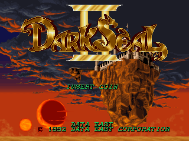

# 다크 실 2 — 아케이드

아케이드 **다크 실 2** 한글 번역 패치 프로젝트입니다. 다크 실 시리즈 두 번째 작품인 판타지 액션 RPG입니다.

> **정식 배포 v1.0.3**

<!-- game-preview:start -->

  

**타이틀 · 원문 로고** — 사용자가 촬영한 FBNeo 타이틀 화면. 현재 설치 패치 9개가 공개 v1.0.3과 해시 일치하며 타이틀 로고는 원문입니다.
<!-- game-preview:end -->

## 다운로드 및 적용 방법

1. 아래 체크섬 또는 상세 안내와 일치하는 원본을 준비합니다.
2. [최종 배포 패치 다운로드](https://github.com/akuma815/arcade-dark-seal-2-kr-patch/releases/tag/v1.0.3)에서 ZIP을 받아 모두 압축 해제합니다.
3. ZIP의 `support` 폴더를 FBNeo 설치 폴더에 복사합니다.
4. IPS Manager에서 `Korean`을 선택하거나 `fbneo64.exe darkseal2 -ips Korean`으로 실행합니다.

## 주의사항

- 일본판 v2.1의 darkseal2 및 부모 wizdfire 세트가 필요합니다.
- FBNeo IPS 패치이며 ROM 이름과 CRC가 일치해야 합니다.
- 원본 게임·BIOS 및 패치가 적용된 게임 이미지는 포함하지 않습니다.

## 체크섬

| 구분 | SHA-256 |
| --- | --- |
| 패치 파일 `Korean-jb-00-3_3a.ips` | `3ccb3897f63054d43684b6b179a851d36970b7142b8175b8e8aded5da0deb5fc` |
| 패치 파일 `Korean-jb-01-3_3d.ips` | `1d3ee0bb5b1a7ac78a03527a8f94622ad850eacf6aa2c6e6b1c8855732e05d9b` |
| 패치 파일 `Korean-jb-04_10d.ips` | `bb19019148def91ed5e299c8f8b077e930b0aa64b2f5babf81b7cb353bada5d0` |
| 패치 파일 `Korean-jb-05_12d.ips` | `8acdec478f37d6e80717c265b48a5db11a73214c99dba30a81d4c95825bc42e1` |
| 패치 파일 `Korean-mas02.ips` | `dc27d3586d3b21866df3ef704e7044f4dabae0d55ea8dcce68e0685d1d75fa95` |
| 패치 파일 `Korean-mas03.ips` | `482a53bb100044bd1c9cfb1f1b7e42ce8c36d2567cebe281b52de7be8ba21ddd` |
| 패치 파일 `Korean-mas12.ips` | `48807ed24b0bede4cf823682fed05844994107a975572587a4d781491f8b7c21` |
| 패치 파일 `Korean-mas13.ips` | `c61fce4731fc2060c1dea319a6dd0984c17dd8a6ba4b2de75d30024052195c35` |
| 배포 압축 파일 | `7b20e69353f0862d12e1ee73a2cd710033fac81ee8dfe409d3a3260e8d6b57b6` |

지원 원본의 세트·리비전 및 해시는 [상세 패치 안내](docs/PATCH_GUIDE.txt)를 확인하세요.

## 소스 및 작업 기록

[공개 소스 구성과 빌드 전제](docs/SOURCE_GUIDE.md) · [상세 패치 안내](docs/PATCH_GUIDE.txt)
